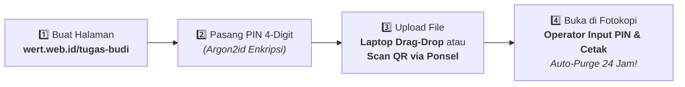
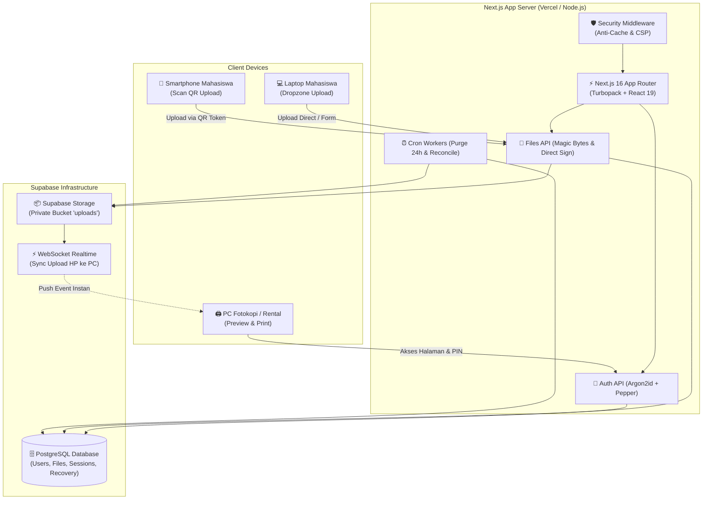

# <p align="center"> <b>wert.web.id</b></p>

<h3 align="center">Akses, Pratinjau, dan Cetak Dokumen Tugas dari Mana Saja — Tanpa Perlu Login WhatsApp di Komputer Fotokopian</h3>

<p align="center">
  <a href="https://wert.web.id"></a>
  <a href="https://github.com/febriosein/wert"></a>
  <a href="#-panduan-instalasi-lokal"></a>
</p>

<p align="center">
  
  
  
  
  
  
  
</p>

---

## 📑 Daftar Isi (Interactive Jump)

- [🎯 Mengapa Wert? (Problem vs. Solution)](#-mengapa-wert-problem-vs-solution)
- [🔄 Alur Penggunaan & Arsitektur](#-alur-penggunaan--arsitektur)
  - [1. Alur 4-Langkah Mahasiswa & Fotokopi](#1-alur-4-langkah-mahasiswa--fotokopi)
  - [2. Arsitektur Sistem](#2-arsitektur-sistem)
- [✨ Fitur-Fitur Unggulan](#-fitur-fitur-unggulan)
  - [🛡️ Privasi Mutlak & Zero-PII](#-privasi-mutlak--zero-pii)
  - [📱 Upload Instan via Scan QR Mobile](#-upload-instan-via-scan-qr-mobile)
  - [👁️ Universal In-Browser Viewer & ZIP Inspector](#-universal-in-browser-viewer--zip-inspector)
  - [🔒 Proteksi Khusus Komputer Rental](#-proteksi-khusus-komputer-rental)
  - [🎨 Tampilan Responsif & Tactile Neubrutalism](#-tampilan-responsif--tactile-neubrutalism)
- [🛠️ Tech Stack](#️-tech-stack)
- [🚀 Panduan Instalasi Lokal](#-panduan-instalasi-lokal)
  - [Prasyarat](#prasyarat)
  - [Langkah 1: Clone Repositori](#langkah-1-clone-repositori)
  - [Langkah 2: Pasang Dependensi](#langkah-2-pasang-dependensi)
  - [Langkah 3: Konfigurasi Environment (.env.local)](#langkah-3-konfigurasi-environment-envlocal)
  - [Langkah 4: Setup Database & Storage Supabase](#langkah-4-setup-database--storage-supabase)
  - [Langkah 5: Jalankan Server Development](#langkah-5-jalankan-server-development)
- [📡 Dokumentasi API Endpoints](#-dokumentasi-api-endpoints)
- [🧪 Pengujian & Otomasi](#-pengujian--otomasi)
- [📂 Struktur Direktori](#-struktur-direktori)
- [💡 Pertanyaan Sering Diajukan (FAQ)](#-pertanyaan-sering-diajukan-faq)
- [🤝 Kontribusi & Lisensi](#-kontribusi--lisensi)

---

## 🎯 Mengapa Wert? (Problem vs. Solution)

Mencetak tugas di tempat fotokopi atau warnet umum selama ini merepotkan dan berbahaya bagi privasi mahasiswa:

| Masalah Metode Tradisional ❌ | Solusi Modern dari Wert (`wert.web.id`) ✅ |
|---|---|
| **Login WhatsApp Web di PC Fotokopi**: Berisiko lupa *logout*, riwayat chat pribadi & foto intim tertinggal dan bisa dibaca operator/pelanggan lain. | **Tanpa WhatsApp / Zero-PII**: Cukup buka `wert.web.id/@nama-tugas`. Tidak minta nomor HP, email, maupun password akun chat Anda. |
| **Colok Flashdisk di PC Umum**: Sangat rentan terkena virus shortcut, ransomware, atau malware yang merusak file skripsi. | **100% Berbasis Cloud**: Transfer file langsung dari laptop/HP Anda ke browser fotokopi lewat link aman. Bebas resiko virus USB. |
| **Beda Versi Word Merusak Layout**: File `.docx` terbuka berantakan font & margin-nya di MS Office jadul fotokopi. | **In-Browser Document Preview**: Pratinjau langsung PDF & gambar, atau cetak langsung tanpa perlu membuka aplikasi Office lokal. |
| **File Tertinggal di Folder Download PC Fotokopi**: Dokumen rahasia tersimpan selamanya di harddisk komputer rental. | **Hapus Otomatis (Auto-Purge 24 Jam)**: File tugas Anda otomatis terhapus permanen dari server dan storage setelah 24 jam. |

---

## 🔄 Alur Penggunaan & Arsitektur

### 1. Alur 4-Langkah Mahasiswa & Fotokopi



<details>
<summary><b>🔍 Rincian Interaksi Tiap Langkah (Klik untuk membuka)</b></summary>

1. **Langkah 1 — Buat & Buka Halaman**:
   - Pengguna mengunjungi `wert.web.id` dan memasukkan nama halaman unik (misal: `@skripsi-final` atau `@tugas-makalah`).
   - Sistem memeriksa ketersediaan secara instan via endpoint `/api/auth/check`.

2. **Langkah 2 — Buat / Masukkan PIN Keamanan 4 Digit**:
   - Jika halaman baru: Pengguna membuat PIN 4-digit dan langsung menerima **12-Karakter Recovery Code** (`WERT-XXXX-XXXX`) untuk cadangan darurat.
   - Jika halaman sudah ada: Pengguna memasukkan PIN 4 digit untuk membuka akses.

3. **Langkah 3 — Upload Dokumen (Laptop atau Scan QR Ponsel)**:
   - Dari Laptop: Drag & drop dokumen langsung ke Dropzone browser.
   - Dari Ponsel: Di layar laptop fotokopi muncul tombol **Upload dari HP** yang menampilkan QR Code dinamis. Scan QR dengan kamera HP tanpa perlu install aplikasi, langsung pilih file dari galeri/penyimpanan HP. File langsung muncul secara *realtime* di layar fotokopi!

4. **Langkah 4 — Cetak & Bersihkan**:
   - Buka dokumen di pratinjau browser, tekan tombol **Cetak Sekarang**.
   - Selesai mencetak, klik **Keluar**. File Anda otomatis musnah dari server dalam 24 jam (atau bisa langsung dihapus manual saat itu juga).

</details>

---

### 2. Arsitektur Sistem



---

## ✨ Fitur-Fitur Unggulan

### 🛡️ Privasi Mutlak & Zero-PII
- **Tanpa Registrasi Berbelit**: Tidak meminta email, nomor telepon, Google OAuth, atau identitas pribadi apa pun.
- **PIN 4-Digit Terenkripsi Kuat**: Password/PIN di-hash menggunakan **Argon2id** (standar kriptografi modern pemenang *Password Hashing Competition*) diperkuat dengan **server-side Pepper**.
- **12-Karakter Recovery Code**: Diformat dengan Base32 `WERT-XXXX-XXXX` tanpa karakter ambigu (`0`, `O`, `1`, `I`) untuk pemulihan akses jika lupa PIN.

### 📱 Upload Instan via Scan QR Mobile
- **Sinkronisasi Realtime**: Scan QR di layar PC fotokopi menggunakan kamera HP biasa. Begitu file diunggah di ponsel, file langsung muncul di layar PC fotokopi tanpa perlu me-refresh halaman!
- **Kamera & Galeri**: Mendukung pengambilan foto dokumen langsung dari kamera HP atau memilih file dokumen (PDF, Word, Excel, PowerPoint, Gambar, ZIP).
- **Validasi Magic Bytes**: Melakukan inspeksi byte awal file (*file signatures*) di sisi client & server untuk mencegah eksploitasi file berbahaya yang menyamar sebagai dokumen.

### 👁️ Universal In-Browser Viewer & ZIP Inspector
- **Pratinjau PDF & Gambar**: Membuka langsung PDF, JPEG, PNG, dan WebP di modal pratinjau yang responsif.
- **Pemeriksa Arsip ZIP Tanpa Ekstraksi (*Zero-Extraction*)**: Membaca *Central Directory* ZIP secara aman tanpa mengekstrak isinya ke disk, mencegah serangan *Zip Slip* atau *Zip Bomb*.
- **Tombol Cetak Cepat 1-Klik**: Membuka dialog print browser dalam tata letak yang siap cetak.

### 🔒 Proteksi Khusus Komputer Rental
- **Header Anti-Cache Ketat**: Menghindari file tersimpan di cache disk browser umum dengan header:
  ```http
  Cache-Control: private, no-cache, no-store, must-revalidate
  Pragma: no-cache
  Expires: 0
  ```
- **Proteksi IDOR (Insecure Direct Object References)**: Validasi sesi ganda memastikan tidak ada pihak lain yang bisa menebak ID atau mengakses file pengguna lain.
- **Auto-Delete Timer (24 Jam)**: File otomatis dihapus tuntas oleh Cron Worker setelah 24 jam.

### 🎨 Tampilan Responsif & Tactile Neubrutalism
- **Desain Tactile Modern**: Menggunakan palet ramah lingkungan (*Deep Green* `#087443`, *Mint* `#E3F8EC`, *Dark Ink* `#10241B`) dengan efek stiker bayangan tebal yang interaktif.
- **Responsif di Seluruh Ukuran Layar**: Dioptimalkan khusus untuk layar ponsel (320px–480px), tablet, hingga monitor komputer rental dengan *touch targets* ramah jari (minimal 44px).
- **Tipografi Premium**: Kombinasi *Bricolage Grotesque* untuk judul tegas dan *Plus Jakarta Sans* untuk keterbacaan teks yang bersih.

---

## 🛠️ Tech Stack

| Kategori | Teknologi | Deskripsi |
|---|---|---|
| **Core Framework** | [Next.js 16.4.2](https://nextjs.org/) | App Router dengan Turbopack bundling untuk build ultra-cepat |
| **Frontend Library** | [React 19.3.0](https://react.dev/) | React Server Components & Action transitions |
| **Styling** | [Tailwind CSS v4.0](https://tailwindcss.com/) | Engine CSS terbaru dengan performa tinggi & zero-runtime |
| **Icons & Visuals** | [Lucide React](https://lucide.dev/) | Ikon vektor modern, ringan, dan konsisten |
| **Database & Auth** | [Supabase PostgreSQL](https://supabase.com/) | Relational database dengan Row-Level Security (RLS) |
| **Object Storage** | [Supabase Storage](https://supabase.com/storage) | Private object store untuk dokumen dengan signed URLs |
| **Realtime Engine** | [Supabase Realtime](https://supabase.com/realtime) | WebSocket publish-subscribe untuk notifikasi upload mobile |
| **Kriptografi** | `@node-rs/argon2` | Native Rust Argon2id binding untuk hashing PIN cepat & aman |
| **QR Code Engine** | `qrcode` | Generator canvas/SVG QR dinamis untuk sesi transfer mobile |
| **Doc Processing** | `mammoth` | Utilitas pembacaan & parser struktur dokumen |

---

## 🚀 Panduan Instalasi Lokal

### Prasyarat
- **Node.js** v20.x atau v22.x LTS ([Unduh Node.js](https://nodejs.org/))
- **npm** v10+ (bawaan Node.js)
- Proyek [Supabase](https://supabase.com/) aktif (Bisa akun gratis)
- Git terpasang di komputer Anda

---

### Langkah 1: Clone Repositori
```bash
git clone https://github.com/febriosein/wert.git
cd wert
```

---

### Langkah 2: Pasang Dependensi
```bash
npm install
```

---

### Langkah 3: Konfigurasi Environment (`.env.local`)
Salin file template `.env.example`:
```bash
cp .env.example .env.local
```

Buka file `.env.local` dan lengkapi konfigurasi berikut:

```env
# ==========================================
# 🌐 URL Aplikasi
# ==========================================
NEXT_PUBLIC_APP_URL=http://localhost:3000

# ==========================================
# ⚡ Konfigurasi Supabase
# ==========================================
NEXT_PUBLIC_SUPABASE_URL=https://proyek-anda.supabase.co
NEXT_PUBLIC_SUPABASE_ANON_KEY=eyJhbGciOiJIUzI1NiIsInR5cCI6IkpXVCJ9...
SUPABASE_SERVICE_ROLE_KEY=eyJhbGciOiJIUzI1NiIsInR5cCI6IkpXVCJ9...

# ==========================================
# 🔐 Keamanan & Kriptografi
# ==========================================
# Gunakan string acak minimal 32 karakter untuk pepper dan session secret
PIN_PEPPER=ganti_dengan_string_acak_rahasia_untuk_pepper_argon2
SESSION_SECRET=ganti_dengan_string_acak_32_karakter_session_secret
CRON_SECRET=ganti_dengan_string_acak_untuk_verifikasi_cron_job
```

> [!TIP]
> Anda dapat membuat string acak 32 karakter dengan cepat di terminal menggunakan Node.js:
> ```bash
> node -e "console.log(require('crypto').randomBytes(32).toString('hex'))"
> ```

---

### Langkah 4: Setup Database & Storage Supabase

1. Buka **Supabase Dashboard** -> pilih proyek Anda -> buka menu **SQL Editor**.
2. Jalankan isi file migrasi secara berurutan:
   - 📄 [`supabase/migrations/00001_initial_schema.sql`](supabase/migrations/00001_initial_schema.sql)
   - 📄 [`supabase/migrations/00002_fix_username_regex.sql`](supabase/migrations/00002_fix_username_regex.sql)
3. Buka menu **Storage** di Supabase Dashboard:
   - Buat bucket baru bernama `uploads`.
   - Pastikan bucket diset sebagai **Private** (bukan public).

---

### Langkah 5: Jalankan Server Development

```bash
npm run dev
```

Buka browser Anda dan kunjungi [http://localhost:3000](http://localhost:3000).

---

## 📡 Dokumentasi API Endpoints

<details>
<summary><b>🔐 1. Autentikasi & Akun (<code>/api/auth/*</code>) — Klik untuk melihat</b></summary>

| Metode | Endpoint | Deskripsi | Parameter Utama |
|---|---|---|---|
| `POST` | `/api/auth/check` | Memeriksa ketersediaan `@username` dan status PIN | `{ "username": "tugas-budi" }` |
| `POST` | `/api/auth/register` | Mendaftarkan halaman baru dengan PIN & mendapatkan Recovery Code | `{ "username": "tugas-budi", "pin": "1234" }` |
| `POST` | `/api/auth/login` | Verifikasi PIN dan membuat cookie sesi HttpOnly | `{ "username": "tugas-budi", "pin": "1234" }` |
| `POST` | `/api/auth/recover` | Mereset PIN menggunakan 12-karakter Recovery Code | `{ "username": "tugas-budi", "recoveryCode": "WERT-XXXX-XXXX", "newPin": "5678" }` |
| `POST` | `/api/auth/logout` | Menghapus cookie sesi aktif pengguna | - |

</details>

<details>
<summary><b>📁 2. Manajemen Dokumen (<code>/api/files/*</code>) — Klik untuk melihat</b></summary>

| Metode | Endpoint | Deskripsi | Parameter Utama |
|---|---|---|---|
| `GET` | `/api/files` | Mengambil daftar seluruh file di folder pengguna aktif | Cookie Sesi |
| `POST` | `/api/files/init` | Menginisialisasi upload langsung (membuat presigned storage URL) | `{ "filename": "skripsi.pdf", "fileSize": 1048576, "mimeType": "application/pdf" }` |
| `POST` | `/api/files/complete` | Memverifikasi upload selesai dan mencatat metadata di DB | `{ "fileId": "uuid", "storagePath": "path/to/file" }` |
| `GET` | `/api/files/[id]/preview` | Mendapatkan URL pratinjau dokumen aman (dengan header anti-cache) | Path Param `id` |
| `GET` | `/api/files/[id]/download` | Mengunduh file dokumen asli | Path Param `id` |
| `DELETE` | `/api/files/[id]` | Menghapus file secara permanen dari Storage dan Database | Path Param `id` |
| `GET` | `/api/files/[id]/archive-contents` | Menginspeksi isi file ZIP tanpa melakukan ekstraksi (*zero-extraction*) | Path Param `id` |
| `POST` | `/api/files/[id]/replace` | Mengganti file yang sudah ada dengan versi baru secara atomik | Multi-part form data |

</details>

<details>
<summary><b>📱 3. Sesi Upload Mobile QR (<code>/api/u/*</code> & <code>/api/upload-sessions</code>) — Klik untuk melihat</b></summary>

| Metode | Endpoint | Deskripsi |
|---|---|---|
| `POST` | `/api/upload-sessions` | Menghasilkan token unik untuk QR Code sesi upload dari HP |
| `GET` | `/api/u/[token]` | Memvalidasi token sesi upload mobile saat QR di-scan oleh smartphone |
| `POST` | `/api/u/[token]/upload` | Menerima berkas upload dari browser smartphone mahasiswa |

</details>

<details>
<summary><b>⚙️ 4. Pengaturan & Sistem (<code>/api/settings/*</code>, <code>/api/cron/*</code>, <code>/api/health</code>) — Klik untuk melihat</b></summary>

| Metode | Endpoint | Deskripsi |
|---|---|---|
| `GET` | `/api/health` | Health-check endpoint untuk memantau status aplikasi dan konektivitas |
| `GET` / `PUT` | `/api/settings` | Mengambil atau memperbarui preferensi akun pengguna (misal: durasi auto-delete) |
| `POST` | `/api/settings/pin` | Mengubah PIN 4-digit halaman pengguna |
| `GET` | `/api/cron/purge` | Pekerja latar belakang terjadwal untuk membersihkan file > 24 jam |
| `GET` | `/api/cron/reconcile` | Pekerja rekonsiliasi data orphaned antara Database dan Storage |

</details>

---

## 🧪 Pengujian & Otomasi

Proyek Wert dilengkapi dengan suite pengujian komprehensif untuk memastikan reliabilitas dan keamanan:

```bash
# 1. Menjalankan Golden Test Suite
# Menguji recovery code format, validasi magic bytes, dan parser ZIP
npm test

# 2. Menjalankan Simulasi Pilot Fotokopi (End-to-End)
# Mensimulasikan alur penuh mahasiswa di fotokopian (auth, QR sync, upload, print, IDOR protection)
npm run test:pilot

# 3. Pengecekan Type & Lint
npx tsc --noEmit
npm run lint
```

---

## 📂 Struktur Direktori

```text
wert/
├── public/                 # Favicon, ikon, dan aset statis publik
├── scripts/
│   ├── golden_test.mjs     # Test suite unit: Magic Bytes, ZIP parser, & Recovery Code
│   └── pilot_simulation.mjs # Test suite E2E simulasi alur fotokopi lengkap
├── src/
│   ├── app/
│   │   ├── [username]/     # Halaman dashboard file pengguna (@username)
│   │   │   └── settings/   # Halaman pengaturan PIN & preferensi akun
│   │   ├── api/            # API Route handlers (Auth, Files, QR, Cron, Health)
│   │   ├── bantuan/        # Panduan penggunaan & pusat bantuan
│   │   ├── help/           # Alias route bantuan
│   │   ├── privacy/        # Kebijakan privasi (Zero-PII guarantee)
│   │   ├── terms/          # Syarat dan ketentuan layanan
│   │   ├── u/[token]/      # Halaman penerima upload berkas via scan QR smartphone
│   │   ├── globals.css     # Tailwind CSS v4 styling & neubrutalist custom tokens
│   │   ├── layout.tsx      # Root layout aplikasi (Bricolage Grotesque + Plus Jakarta Sans)
│   │   └── page.tsx        # Homepage interaktif (Buka Halaman, Form PIN, How-It-Works)
│   ├── components/
│   │   ├── DeleteFileModal.tsx     # Konfirmasi hapus file dengan proteksi salah klik
│   │   ├── DocumentViewerModal.tsx # Pratinjau dokumen universal (PDF, Img, ZIP) & Print
│   │   ├── Dropzone.tsx            # Area drag-drop berkas responsif dengan upload progress
│   │   ├── FileCard.tsx            # Kartu dokumen individual dengan badge status & aksi
│   │   ├── HowItWorksSection.tsx   # Panduan 4 langkah bergaya neubrutalis interaktif
│   │   ├── InfoPageLayout.tsx      # Layout standar halaman dokumentasi/legal
│   │   ├── Navbar.tsx              # Navigasi utama dengan branding & status sesi
│   │   └── QrModal.tsx             # Modal penampil QR Code dinamis untuk upload ponsel
│   ├── lib/
│   │   ├── auth/           # Utilitas PIN, Argon2id, Session token, & Recovery code
│   │   ├── storage/        # Validator magic bytes file & pembaca central directory ZIP
│   │   ├── supabase/       # Inisialisasi klien Supabase (Browser & Admin Service Role)
│   │   └── utils.ts        # Helper formatting ukuran file, waktu relatif, & sanitasi
│   └── middleware.ts       # Middleware keamanan (Anti-cache header, CSP, proteksi rute)
├── supabase/
│   └── migrations/         # Skrip DDL skema database PostgreSQL
├── .env.example            # Contoh template konfigurasi environment
├── package.json            # Daftar dependensi & script runner
└── README.md               # Dokumentasi lengkap proyek
```

---

## 💡 Pertanyaan Sering Diajukan (FAQ)

<details>
<summary><b>❓ Apakah operator fotokopi bisa melihat file saya setelah saya pulang?</b></summary>
<br>
<b>Tidak bisa.</b> Wert menerapkan beberapa lapis keamanan:
1. Setelah Anda mengklik tombol <b>Keluar</b> atau menutup tab browser, sesi akses terkunci kembali dengan PIN Anda.
2. Semua file dikirimkan dengan header <code>Cache-Control: no-store</code> sehingga file tidak tersimpan di folder cache/temporary browser komputer fotokopi.
3. Seluruh file Anda otomatis terhapus permanen dari server dalam 24 jam.
</details>

<details>
<summary><b>❓ Apa yang terjadi jika saya lupa PIN 4-Digit saya?</b></summary>
<br>
Saat pertama kali membuat halaman, Anda akan diberikan <b>12-Karakter Recovery Code</b> (contoh: <code>WERT-7K9A-3B2F</code>). Klik tautan <b>"Lupa PIN?"</b> di halaman login, masukkan Recovery Code tersebut, dan Anda dapat langsung membuat PIN baru.
</details>

<details>
<summary><b>❓ Apakah saya perlu menginstal aplikasi tambahan di HP untuk upload via QR?</b></summary>
<br>
<b>Sama sekali tidak perlu.</b> Anda cukup membuka aplikasi Kamera bawaan smartphone Anda, arahkan ke QR Code di layar komputer, dan ketuk tautan yang muncul. Browser HP Anda akan langsung membuka halaman upload instan.
</details>

<details>
<summary><b>❓ Format file apa saja yang didukung?</b></summary>
<br>
Wert mendukung format dokumen yang umum dicetak:
- <b>Dokumen</b>: PDF (`.pdf`), Microsoft Word (`.docx`, `.doc`), Excel (`.xlsx`), PowerPoint (`.pptx`)
- <b>Gambar</b>: JPEG (`.jpg`, `.jpeg`), PNG (`.png`), WebP (`.webp`)
- <b>Arsip</b>: ZIP (`.zip`) dengan fitur penjelajah isi arsip tanpa ekstraksi.
</details>

---

## 🤝 Kontribusi & Lisensi

Kontribusi selalu disambut dengan hangat! Jika Anda ingin menambahkan fitur baru, memperbaiki bug, atau meningkatkan antarmuka:

1. **Fork** repositori ini.
2. Buat branch fitur baru (`git checkout -b fitur/nama-fitur`).
3. Commit perubahan Anda (`git commit -m 'feat: tambah fitur X'`).
4. Pastikan tes lolos (`npm test && npm run test:pilot`).
5. Push ke branch Anda (`git push origin fitur/nama-fitur`).
6. Buka **Pull Request**.

### 📄 Lisensi
Proyek ini dilisensikan di bawah lisensi **[MIT](LICENSE)**.

---

<p align="center">
  Dibuat dengan ❤️ untuk mempermudah kehidupan pencetakan tugas mahasiswa & menjaga privasi di ruang publik.<br/>
  <b><a href="https://wert.web.id">Kunjungi wert.web.id</a></b>
</p>
